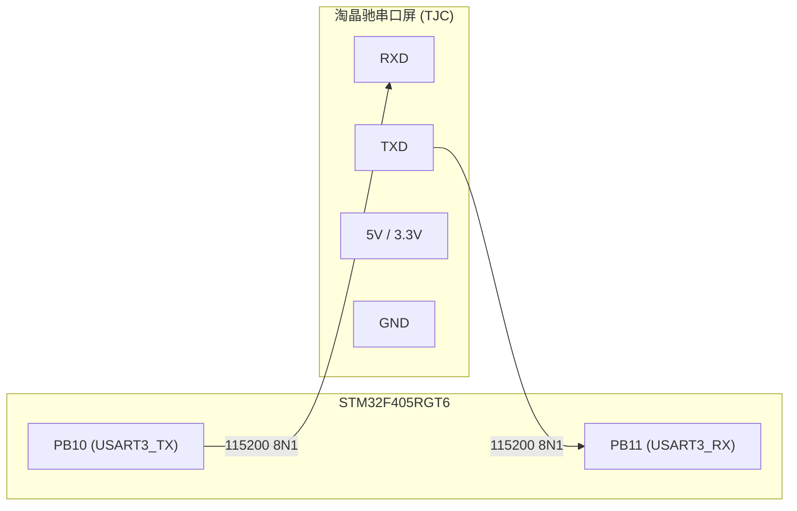
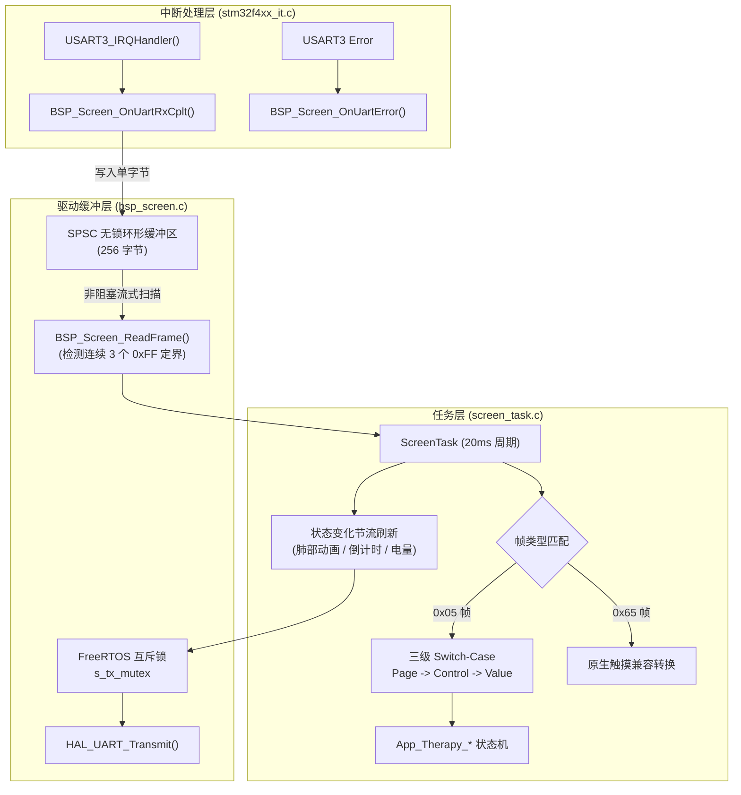

# 淘晶驰（TJC）串口屏驱动与交互系统设计手册

> **所属项目**：脂肪肝治疗仪（慢呼吸诱导 + 低频穴位电刺激）嵌入式固件  
> **微控制器**：STM32F405RGT6 (ARM Cortex-M4, 168MHz)  
> **驱动文件路径**：`Screen/bsp_screen.h`、`Screen/bsp_screen.c`、`Screen/screen_task.c`  
> **文档版本**：V1.0  

---

## 目录
1. [模块概述与硬件拓扑](#1-模块概述与硬件拓扑)
2. [通信协议规范](#2-通信协议规范)
   - [2.1 下行协议（MCU -> 串口屏）](#21-下行协议mcu---串口屏)
   - [2.2 上行协议（串口屏 -> MCU）](#22-上行协议串口屏---mcu)
3. [源码结构与设计剖析](#3-源码结构与设计剖析)
   - [3.1 bsp_screen.h 头文件设计](#31-bsp_screenh-头文件设计)
   - [3.2 bsp_screen.c 底层驱动与缓冲机制](#32-bsp_screenc-底层驱动与缓冲机制)
   - [3.3 screen_task.c 任务层与三级分发架构](#33-screen_taskc-任务层与三级分发架构)
4. [淘晶驰上位机（USART HMI）联调配置指南](#4-淘晶驰上位机usart-hmi联调配置指南)
   - [4.1 控件命名对照表](#41-控件命名对照表)
   - [4.2 触摸事件脚本编写（printh 语法）](#42-触摸事件脚本编写printh-语法)
5. [高可靠性与抗干扰设计保障](#5-高可靠性与抗干扰设计保障)
6. [快速上手与调用指南](#6-快速上手与调用指南)

---

## 1. 模块概述与硬件拓扑

本项目采用**淘晶驰（USART HMI）智能串口屏**作为人机交互主界面，负责显示治疗模式选择、实时呼吸引导肺部充盈动画、刺激频率与强度档位、治疗倒计时、电极脱落告警及电池电量等信息，同时接收用户触摸按键指令并下发给主控状态机。

### 硬件拓扑与引脚定义


- **通信串口**：USART3
- **引脚分配**：TX = PB10，RX = PB11
- **波特率**：`115200 bps`，数据位 8，停止位 1，无校验（8N1）
- **电气特性**：3.3V TTL 电平

---

## 2. 通信协议规范

### 2.1 下行协议（MCU -> 串口屏）
MCU 向串口屏发送标准的 **ASCII 字符串文本指令**，每条指令末尾必须附加 **3 个连续的 `0xFF` 字节** 作为帧结束符（`\xFF\xFF\xFF`）。

| 指令类型 | 指令模板 | 示例代码 | 功能说明 |
| :--- | :--- | :--- | :--- |
| **页面跳转** | `page <page_name>` | `page running\xFF\xFF\xFF` | 切换至运行主界面 |
| **数值赋值** | `<obj>.<attr>=<val>` | `lung.val=75\xFF\xFF\xFF` | 更新肺部进度条为 75% |
| **文本赋值** | `<obj>.<attr>="<txt>"` | `t_time.txt="15:00"\xFF\xFF\xFF` | 刷新倒计时为 15 分 00 秒 |
| **控件显隐** | `vis <obj>,<0/1>` | `vis w1,1\xFF\xFF\xFF` | 显示 1 通道电极片脱落告警图标 |

---

### 2.2 上行协议（串口屏 -> MCU）
串口屏向 MCU 发送的数据帧采用两种格式：**推荐的自定义三级控制帧**与**原生触摸事件帧**。两者的结尾同样以 3 字节 `0xFF 0xFF 0xFF` 定界。

#### 方案 A：自定义三级控制帧（借鉴经典 FPM 架构，主推荐）
帧头固定为 `0x05`，后续依次携带页面号、控件号与动作数值：
```text
+------+------+---------+-------+--------+--------+--------+
| 0x05 | page | control | value |  0xFF  |  0xFF  |  0xFF  |
+------+------+---------+-------+--------+--------+--------+
  1B     1B       1B       1B       1B       1B       1B
```
- **0x05**：自定义帧头标识符。
- **page**：当前页面 ID（例如 `0x00` 主菜单，`0x01` 呼吸模式选择）。
- **control**：该页面上的按键或控件编号（从 `0x01` 起计数）。
- **value**：按键按下值或滑块数值（如 `0x01` 单击按下，`0x02` 确认双击，或数值 `0~100`）。
- **0xFF 0xFF 0xFF**：固定 3 字节结束符。

#### 方案 B：淘晶驰原生触摸事件帧（回退兼容）
当屏幕页面上某些轻量级控件未手写 `printh` 脚本时，屏端会自动发送原生触摸事件帧：
```text
+------+------+---------+-------+--------+--------+--------+
| 0x65 | page | comp_id | event |  0xFF  |  0xFF  |  0xFF  |
+------+------+---------+-------+--------+--------+--------+
```
- **0x65**：原生触摸帧头。
- **page**：当前页面序号。
- **comp_id**：控件原始 ID。
- **event**：事件类型（`0x01`=按下，`0x00`=弹起）。在驱动层中仅响应 `0x00` 弹起，规避长按连发。

---

## 3. 源码结构与设计剖析

模块由 3 个核心文件组成：
- `bsp_screen.h`：数据结构、协议枚举与对外纯净函数原型。
- `bsp_screen.c`：底层 SPSC 无锁环形缓冲区、中断自愈、0xFF 定界组帧与带互斥锁的发送接口。
- `screen_task.c`：FreeRTOS 独立运行任务，包含三级 Switch-Case 业务分发与按需节流刷新逻辑。



---

### 3.1 `bsp_screen.h` 头文件设计

#### 1. 纯净函数声明规范
遵照极简头文件设计规范，头文件不承载大段多行功能解释（所有详细逻辑注释全部集中在 `.c` 文件定义处），避免跨文件引用时的头文件膨胀与跳转干扰。

#### 2. 页面枚举与协议常量定义
```c
#define SCREEN_FRAME_HDR_CTRL   0x05U   /* 自定义三级控制帧帧头 */
#define SCREEN_FRAME_HDR_TOUCH  0x65U   /* 原生触摸事件帧头 */
#define SCREEN_FRAME_MAX_DATA   48U     /* 单帧最大负载有效载荷 */

typedef enum {
    SCREEN_PAGE_START       = 0x00U, /* 主菜单页 */
    SCREEN_PAGE_BREATH_SEL  = 0x01U, /* 呼吸子模式选择页 */
    SCREEN_PAGE_STIM_SEL    = 0x02U, /* 电刺激波形选择页 */
    SCREEN_PAGE_TREAT_RUN   = 0x03U, /* 治疗就绪/运行/暂停页 */
    SCREEN_PAGE_SETTINGS    = 0x04U, /* 系统设置页 */
    SCREEN_PAGE_END         = 0x05U  /* 治疗结束结算页 */
} ScreenPageId_t;
```

#### 3. 帧数据结构体 `ScreenFrame_t`
```c
typedef struct {
    uint8_t header;                         /* 帧头 (0x05 / 0x65) */
    uint8_t page;                           /* 页面编号 */
    uint8_t control;                        /* 控件功能编号 */
    uint8_t value;                          /* 动作值/参数值 */
    uint8_t raw[SCREEN_FRAME_MAX_DATA];     /* 剥离 0xFF 结束符后的原始载荷 */
    uint8_t len;                            /* 有效载荷字节长度 */
} ScreenFrame_t;
```

---

### 3.2 `bsp_screen.c` 底层驱动与缓冲机制

#### 1. SPSC（单生产者-单消费者）无锁环形缓冲区
- **生产者（Producer）**：USART3 中断服务函数 `BSP_Screen_OnUartRxCplt()`，仅更新写入游标 `s_rx_head`。
- **消费者（Consumer）**：FreeRTOS 任务函数 `BSP_Screen_ReadFrame()`，仅更新读取游标 `s_rx_tail`。
- **设计优势**：由于 Cortex-M4 平台对 16 位/32 位对齐数据具备单周期原子操作特性，且生产者与消费者各管各的游标，因此**读取与写入过程完全无需关闭全局中断（`__disable_irq()`）**，零关中断延时，不影响高精度的微秒级定时器电刺激脉冲。

```c
#define SCREEN_RX_RING_SIZE 256U
static uint8_t           s_rx_ring[SCREEN_RX_RING_SIZE];
static volatile uint16_t s_rx_head = 0U;            /* ISR 专有更新 */
static volatile uint16_t s_rx_tail = 0U;            /* 任务层专有更新 */
static volatile uint32_t s_rx_overflow_cnt = 0U;    /* 溢出保护计数器 */
```

#### 2. 中断单字节接收与 ORE 硬件故障自愈
USART3 单字节接收采用轮转触发，当中断触发后执行：
```c
void BSP_Screen_OnUartRxCplt(void)
{
    uint16_t next = (uint16_t)((s_rx_head + 1U) % SCREEN_RX_RING_SIZE);
    if (next != s_rx_tail) {
        s_rx_ring[s_rx_head] = s_rx_byte_it;
        s_rx_head = next;
    } else {
        s_rx_overflow_cnt++; /* 满则丢弃当前字节，防止破坏旧帧 */
    }
    HAL_UART_Receive_IT(&huart3, &s_rx_byte_it, 1U); /* 立即重装中断 */
}
```
**异常自愈（`BSP_Screen_OnUartError`）**：  
屏幕上电插拔或总线瞬间尖峰脉冲可能引起 STM32 USART 产生 `ORE`（Overrun Error，过载错误）、`FE`（帧错误）或 `NE`（噪声错误）。STM32 硬件在发生 ORE 时会**自动关闭接收使能**并锁定中断。驱动中实现错误恢复回调，在错误发生后清除全部标志并重新拉起接收，彻底解决串口“跑几小时偶发死锁”的工业顽疾。

#### 3. 连续 3 字节 `0xFF` 流式定界组帧算法
`BSP_Screen_ReadFrame(ScreenFrame_t *frame)` 内部维持一个流式滑动计数器 `s_ff_cnt`：
1. 每次从环形缓冲区取出一字节放入 `s_frame_buf`。
2. 若字节等于 `0xFF`，则计数器 `s_ff_cnt++`；否则 `s_ff_cnt = 0`。
3. 当 `s_ff_cnt == 3` 时，判定捕获一帧完整报文！
4. 截断剥除末尾 3 个 `0xFF`，提取 `raw[0]~raw[len-1]`，并直接填入 `frame->header`、`frame->page`、`frame->control`、`frame->value`，供应用层消费。

#### 4. 线程安全的多任务并发下发保护
屏幕可能同时被主任务（更新状态）、音频任务（提示语弹窗）、屏幕任务（动画进度）调用。为杜绝多个线程交替调用 `HAL_UART_Transmit` 产生字节交叉穿插导致串口屏语法解析失败，驱动内建了 FreeRTOS 互斥锁 `s_tx_mutex`：
```c
static void screen_uart_send_bytes(const uint8_t *data, uint16_t len)
{
    uint8_t locked = 0U;
    if (s_tx_mutex != NULL && xTaskGetSchedulerState() == taskSCHEDULER_RUNNING && __get_IPSR() == 0U) {
        if (osMutexWait(s_tx_mutex, 50U) == osOK) {
            locked = 1U;
        }
    }
    HAL_UART_Transmit(&huart3, (uint8_t *)data, len, 50U);
    if (locked) {
        osMutexRelease(s_tx_mutex);
    }
}
```

---

### 3.3 `screen_task.c` 任务层与三级分发架构

`ScreenTask` 是 FreeRTOS 下的独立周期任务，运行周期为 **20 ms**。

#### 1. 经典三级嵌套 Switch-Case 分发框架
当成功提取到 `0x05` 控制帧时，进入 `Screen_HandleCtrlFrame(page, control, value)`：
- **第一级：`switch (page)`**  
  按照 UI 当前处于的界面分支（`SCREEN_PAGE_START`、`SCREEN_PAGE_BREATH_SEL`、`SCREEN_PAGE_TREAT_RUN` 等）划分大模块。
- **第二级：`switch (control)`**  
  按照该界面上的具体交互控件编号区分。如在治疗运行页中：
  - `0x01`：启停按钮
  - `0x02`：返回主菜单按钮
  - `0x10`：频率调节滑块
  - `0x11~0x13`：通道 1~3 强度步进器
- **第三级：`switch (value)` 或直接数值赋值**  
  判断按钮动作状态（`0x01`=按下）或接收具体调节值（如频率 `0~100Hz`，强度档位 `0~10`）。

三级分发清晰直观，后续若要在某页面新增一个按钮，只需找到对应 `case page` 并在下方追加一个 `case control`，完全不破坏其余页面的既有逻辑。

#### 2. 按需节流刷新机制（Throttling）
在 20ms 任务主循环中，如果每 20ms 都强行给屏幕下发指令，串口会被严重堵死，导致屏幕卡顿甚至触摸无响应。因此实现了**基于值变化检测的节流下发策略**：
1. **肺部充盈动画（`g_app.lung_pct`）**：
   维护历史值 `last_lung`，仅当 `g_app.lung_pct != last_lung` 时才触发 `BSP_Screen_SetLungFill()`。
2. **倒计时显示（`t_time.txt`）**：
   通过 `tick_cnt % 10 == 0`（每 200ms）轮询一次剩余秒数，仅在秒数改变（`rem_s != last_remain_s`）时才拼接字符串并下发，避免无谓占用串口总线。
3. **电池电量（`batt.val`）**：
   通过 `tick_cnt % 500 == 0`（每 10 秒）才向屏端同步一次当前电量百分比。

---

## 4. 淘晶驰上位机（USART HMI）联调配置指南

为保证屏端与固件协议无缝对接，在 **USART HMI** 软件中进行 UI 工程设计时，各控件对象名称与脚本编写请严格参照本节规范。

### 4.1 控件命名对照表

| 控件名称 (obj) | 属性 (attr) | 数据类型 | 典型值范围 | 对应业务含义 |
| :--- | :--- | :--- | :--- | :--- |
| `lung` | `val` | 整型 | `0 ~ 100` | 肺部充盈动画进度（0=空，100=满） |
| `arr_in` | `vis` | 显隐 | `0 / 1` | 吸气左导向箭头 |
| `arr_ex` | `vis` | 显隐 | `0 / 1` | 呼气右导向箭头 |
| `gbpm` | `val` | 整型 | `5 ~ 15` | 当前引导呼吸频率（次/分） |
| `t_time` | `txt` | 字符串 | `"MM:SS"` | 剩余治疗倒计时文本 |
| `freq` | `val` | 整型 | `1 ~ 100` | 电刺激主频率（Hz） |
| `ch1` | `val` | 整型 | `0 ~ 10` | 刺激通道 1 强度档位 |
| `ch2` | `val` | 整型 | `0 ~ 10` | 刺激通道 2 强度档位 |
| `ch3` | `val` | 整型 | `0 ~ 10` | 刺激通道 3 强度档位 |
| `w1` | `vis` | 显隐 | `0 / 1` | 通道 1 电极片脱落警告图标 |
| `w2` | `vis` | 显隐 | `0 / 1` | 通道 2 电极片脱落警告图标 |
| `w3` | `vis` | 显隐 | `0 / 1` | 通道 3 电极片脱落警告图标 |
| `batt` | `val` | 整型 | `0 ~ 100` | 电池电量百分比 |
| `vol` | `val` | 整型 | `0 ~ 10` | 语音提示音量（0=静音） |
| `timer` | `val` | 整型 | `5 ~ 30` | 治疗定时总时长（分钟） |
| `ble` | `val` | 整型 | `0 / 1` | 蓝牙广播开关状态 |
| `toast` | `txt` | 字符串 | 文本 | 底部悬浮提示条/弹窗内容 |

---

### 4.2 触摸事件脚本编写（printh 语法）

在 USART HMI 软件中，选定按钮后，在右下角的 **【按下事件】** 或 **【弹起事件】** 中编写 `printh` 指令。  
`printh` 是淘晶驰专用的以十六进制直接输出字节流的语法：

#### 示例 1：主菜单界面（Page 0）点击“呼吸训练”按钮
- **页面**：`SCREEN_PAGE_START` = `0x00`
- **控件**：按键 1 = `0x01`
- **动作**：按下 = `0x01`
- **HMI 弹起事件代码**：
  ```text
  printh 05 00 01 01 ff ff ff
  ```

#### 示例 2：治疗运行界面（Page 3）点击“启停/暂停”按钮
- **页面**：`SCREEN_PAGE_TREAT_RUN` = `0x03`
- **控件**：启停键 = `0x01`
- **动作**：触发 = `0x01`
- **HMI 弹起事件代码**：
  ```text
  printh 05 03 01 01 ff ff ff
  ```

#### 示例 3：治疗运行界面（Page 3）滑块调节通道 1 强度
- 若控件为滑块 `h0`，希望松开时将滑块当前值发送至单片机：
  ```text
  printh 05 03 11
  prints h0.val,1
  printh ff ff ff
  ```

---

## 5. 高可靠性与抗干扰设计保障

1. **防总线堵塞（丢包不卡死）**：  
   环形缓冲区满时自动累加 `s_rx_overflow_cnt` 并丢弃当前新字节，决不覆写未读旧数据，任务层提取完后自动恢复平衡。
2. **防残帧粘包（动态同步机制）**：  
   若中间因电磁干扰丢失字节导致单帧超过 `SCREEN_FRAME_MAX_DATA`（48 字节），提取状态机立刻清空当前组帧缓存并重置 `s_ff_cnt`，重新捕捉下一个合法的 `0xFF 0xFF 0xFF`，保证下一帧恢复同步。
3. **防硬件过载死锁（ORE 错误自愈）**：  
   `BSP_Screen_OnUartError()` 拦截硬件错误回调，针对性清除 `ORE`、`FE`、`NE` 标志位并重装单字节接收，保障恶劣电气环境下串口通信不断连。
4. **防多任务并发穿插（互斥锁）**：  
   所有高层刷新函数统一通过 `screen_uart_send_bytes()`，经 `s_tx_mutex` 互斥保护，即使 3 个任务在同一微秒调用屏幕打印，下发的指令也会严格串行化，决不乱码。

---

## 6. 快速上手与调用指南

### 系统初始化
在 FreeRTOS 启动前的硬件初始化流程（`Core/Src/main.c` 或 `freertos.c`）中：
```c
/* 1. 初始化串口屏底层驱动（开启 USART3 中断） */
BSP_Screen_Init();

/* 2. 注册 FreeRTOS 屏幕任务 */
osThreadDef(ScreenTask, ScreenTask, osPriorityNormal, 0, 512);
osThreadCreate(osThread(ScreenTask), NULL);
```

### 业务层调用示例
在业务状态机或主任务中直接调用语义化 API，无需关心底层字符串格式化与 `0xFF` 结束符：
```c
/* 切换到治疗运行页 */
BSP_Screen_SetPage("running");

/* 更新引导呼吸频率为 8 次/分 */
BSP_Screen_SetGuideBPM(8);

/* 更新剩余时间为 12 分 34 秒 (754 秒) */
BSP_Screen_SetRemainTimeSec(754);

/* 2 通道电极片脱落告警 */
BSP_Screen_SetElectrodeWarn(1, 1);

/* 弹出气泡提示 */
BSP_Screen_ShowToast("Therapy Paused");
```
