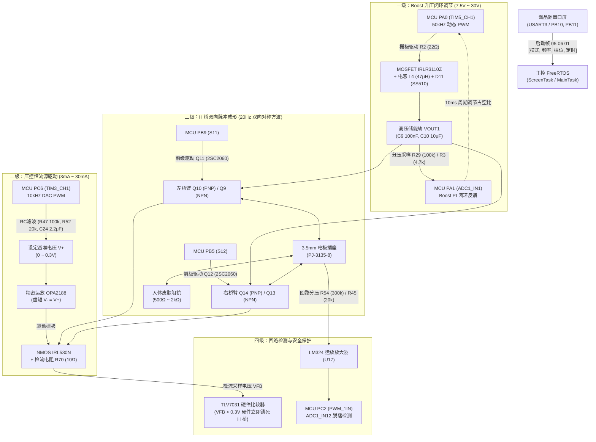
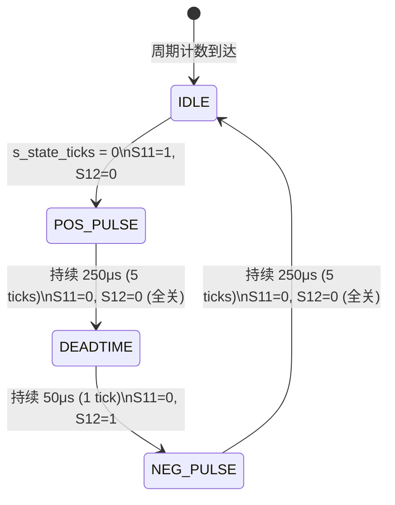

# 电刺激系统 PWM 驱动与硬件电路原理深度解析

---

## 目录
1. [系统总体架构与信号流向](#一系统总体架构与信号流向)
2. [第一阶段：屏幕指令接收与档位参数分发](#二第一阶段屏幕指令接收与档位参数分发)
3. [第二阶段：Boost 高频升压驱动电路详解（PA0 到 VOUT1）](#三第二阶段boost-高频升压驱动电路详解pa0-到-vout1)
4. [第三阶段：压控恒流源驱动电路详解（PC6 到 恒流控制）](#四第三阶段压控恒流源驱动电路详解pc6-到-恒流控制)
5. [第四阶段：H 桥双向方波成形与时序控制（PB9/PB5 到 电极输出）](#五第四阶段h-桥双向方波成形与时序控制pb9pb5-到-电极输出)
6. [第五阶段：电极片脱落检测与自动恢复机制（PC2 与 LM324）](#六第五阶段电极片脱落检测与自动恢复机制pc2-与-lm324)
7. [第六阶段：治疗倒计时结束与安全下电流程](#七第六阶段治疗倒计时结束与安全下电流程)
8. [核心器件清单与参数核对总表](#八核心器件清单与参数核对总表)

---

## 一、系统总体架构与信号流向

本项目为便携式肝病康复电刺激治疗仪，电刺激模块采用 **三路独立通道（CH1、CH2、CH3）**，其核心拓扑由四级联动组成：
$$\textbf{5V电源} \xrightarrow[\text{PA0 (TIM5\_CH1)}]{\textbf{Boost 闭环升压}} \textbf{VOUT (7.5V}\sim\textbf{30V)} \xrightarrow[\text{PB9, PB5}]{\textbf{H桥双向斩波}} \textbf{人体电极} \xrightarrow[\text{PC6 (TIM3\_CH1)}]{\textbf{压控恒流源}} \textbf{检流电阻} \xrightarrow[\text{PC2 (ADC1\_IN12)}]{\textbf{LM324 脱落检测}} \textbf{GND}$$



---

## 二、第一阶段：屏幕指令接收与档位参数分发

### 1. 串口屏协议帧解析
当用户在联合模式界面选择模式、设置定时并调节好通道档位（例如通道1设为 **5档**，基频 **20Hz**，定时 **10分钟**），点击“开始”播放键（`b1`）时，串口屏发送上行十六进制数据帧：
```text
05 06 01 00 14 05 00 00 0A FF FF FF
│  │  │  │  │  │  │  │  │  └────── 淘晶驰结束符 (3字节 0xFF)
│  │  │  │  │  │  │  │  └──────── 定时时间 = 10 分钟 (0x0A)
│  │  │  │  │  │  │  └─────────── 通道3档位 = 0 档 (关闭)
│  │  │  │  │  │  └────────────── 通道2档位 = 0 档 (关闭)
│  │  │  │  │  └───────────────── 通道1档位 = 5 档 (0x05)
│  │  │  │  └──────────────────── 输出频率 = 20 Hz (0x14)
│  │  │  └─────────────────────── 模式 = 连续波 (0x00)
│  │  └────────────────────────── 动作 = 启动运行 (0x01)
│  └───────────────────────────── 页面 = 简易联合治疗页 jianyielec (0x06)
└──────────────────────────────── 帧头 = 控制帧 (0x05)
```

### 2. 软件分发调用链路
1. **`ScreenTask` 提取数据**（`screen_task.c`）：
   * 剥离 `0xFF 0xFF 0xFF` 后校验长度 $\ge 9$，解析出 `mode=0`, `freq=20`, `ch1=5`, `ch2=0`, `ch3=0`, `timer=10`。
   * 调用 `App_Therapy_StartCombo(0, 0, 20, 5, 0, 0, 10)`。
2. **`App_Therapy_StartCombo` 执行初始化**（`therapy_ctrl.c`）：
   * 写入全局变量 `g_app.stim_level[0] = 5`，调用 `BSP_Stim_SetChannelLevel(0, 5)`。
   * 调用 `BSP_Stim_SetWaveType(STIM_WAVE_CONT)` 与 `BSP_Stim_SetBaseFreqHz(20)`。
   * 调用 `BSP_Stim_Enable(1)` 将底层使能标志 `s_enabled` 置 1。
   * 强制重置肺部与吸气指示标 `BSP_Screen_SetBreathArrow(1U)`（向左指示）。

### 3. 各档位对应的电流与理论电压映射表
根据人体阻抗安全规范与设备设计规格，10个档位的电流、参考基准电压与 Boost 目标升压映射如下：

| 刺激档位 | 峰值恒流目标 $I_{\text{peak}}$ | 恒流基准电压 $V_+$ | 恒流 PWM 占空比 (`CC_PWM11`) | Boost 目标高压 $V_{\text{OUT}}$ | Boost 理论占空比 $D$ (输入5V) |
| :---: | :---: | :---: | :---: | :---: | :---: |
| **0 档** | 0 mA（关断） | 0.000 V | 0 / 8400 (0.0%) | 0.0 V（PWM关断） | 0.0% |
| **1 档** | 3 mA | 0.030 V | 91 / 8400 (1.08%) | 7.5 V | 33.3% |
| **2 档** | 6 mA | 0.060 V | 181 / 8400 (2.15%) | 10.0 V | 50.0% |
| **3 档** | 9 mA | 0.090 V | 272 / 8400 (3.24%) | 12.5 V | 60.0% |
| **4 档** | 12 mA | 0.120 V | 362 / 8400 (4.31%) | 15.0 V | 66.7% |
| **5 档** | 15 mA | 0.150 V | 453 / 8400 (5.39%) | 17.5 V | 71.4% |
| **6 档** | 18 mA | 0.180 V | 544 / 8400 (6.48%) | 20.0 V | 75.0% |
| **7 档** | 21 mA | 0.210 V | 634 / 8400 (7.55%) | 22.5 V | 77.8% |
| **8 档** | 24 mA | 0.240 V | 725 / 8400 (8.63%) | 25.0 V | 80.0% |
| **9 档** | 27 mA | 0.270 V | 815 / 8400 (9.70%) | 27.5 V | 81.8% |
| **10 档**| 30 mA | 0.300 V | 906 / 8400 (10.79%)| 30.0 V | 83.3% |

---

## 三、第二阶段：Boost 高频升压驱动电路详解（PA0 到 VOUT1）

Boost 电路的作用是将系统 **5V 电源**升压为 **7.5V ~ 30V** 的可调高压轨，用以克服人体皮肤角质层高达 $1\text{k}\Omega\sim 2\text{k}\Omega$ 的阻抗，确保能够驱动恒定电流注入人体深层组织。

对照原理图 `BOOST升压(≤36V).png` 通道 1 逐个元器件拆解分析：

```text
       5V ────┬───[ L4 47μH ]───┬──────[ D11 SS510 ]──────┬───── VOUT1 (7.5V~30V)
              │                 │                         ├───[ C9  100nF ]─── GND
          [ C13 220μF ]        │(Drain)                  ├───[ C10 10μF  ]─── GND
              │               [ Q2 IRLR3110Z ]            │
             GND                │(Source)                [ R29 100kΩ ]
                               GND                        │
  PA0 ───[ R2 22Ω ]───┬─────────┘(Gate)                   ├─── PWM1_Out (接 PA1)
                      │                                   │
                  [ D8 SS34 ]                         [ R3 4.7kΩ ]  [ C11 22pF ]
                      │                                   │              │
                  [ R18 100kΩ ]                          GND            GND
                      │
                     GND
```

### 1. 逐元器件功能与物理工作原理
1. **输入电容 $C_{13}$ (220μF 电解) 与 $C_{46}$ (100nF 陶瓷)**：
   * 并联在 5V 输入端与地之间。220μF 用于平抑开关瞬间的大纹波电流，防止升压开关噪声倒灌回单片机与音频芯片；100nF 滤除超高频毛刺。
2. **储能电感 $L_4$ (47μH 大功率屏蔽电感)**：
   * **充电阶段（Q2 导通）**：Q2 导通时，5V 电源加在 $L_4$ 两端，二极管 D11 反偏截止。电感中的电流线性增加，电流增加率为 $\frac{di}{dt} = \frac{V_{in}}{L}$，电能转化为磁场能量储存在电感线圈中。
   * **放电阶段（Q2 关断）**：Q2 关断瞬间，电感电流不能突变，产生感应电动势（左负右正）。该电动势与 5V 输入电源叠加，冲开肖特基二极管 D11 向输出电容充电：
     $$V_{L} = L \frac{di}{dt} \implies V_{\text{OUT}} = V_{in} + V_L = \frac{V_{in}}{1 - D}$$
     通过改变 PA0 的占空比 $D$（0% ~ 83%），即可在输出端获得高达 30V 的稳定电压。
3. **主开关管 $Q_2$ (IRLR3110ZTRPBF-TP, N-MOSFET)**：
   * 关键参数：耐压 100V、额定电流 42A、导通内阻仅 $14\text{ m}\Omega$。极低的导通内阻极大地降低了开关管的发热损耗。
4. **栅极驱动电阻 $R_2$ (22Ω)**：
   * 串联在单片机 PA0 引脚与 MOSFET 栅极（Gate）之间。一方面抑制由引线寄生电感与 MOS 输入寄生电容 $C_{iss}$ 引起的串联谐振高频振铃；另一方面将单片机 IO 口充放电尖峰电流限制在安全范围（$3.3\text{V} / 22\Omega \approx 150\text{mA}$ 瞬态）。
5. **栅极下拉电阻 $R_{18}$ (100kΩ) 与放电二极管 $D_8$ (SS34 肖特基)**：
   * $R_{18}$ 确保单片机上电复位期间 PA0 处于浮空高阻态时，Q2 栅极被牢固下拉至 GND，杜绝误导通烧毁电感。
   * $D_8$ 与栅极并联，提供关断时的极速放电通路，显著缩短 MOS 管关断沿时间，减少交叠开关损耗。
6. **整流肖特基二极管 $D_{11}$ (SS510, 100V / 5A)**：
   * 选用特种肖特基管，具有极高的反向耐压（100V）和极短的反向恢复时间（< 10ns），防止输出端电容高压反向泄放。
7. **输出滤波储能网络 $C_9$ (100nF) 与 $C_{10}$ (10μF / 50V 耐压高频电解)**：
   * 吸收升压后的高频纹波，为后级 H 桥输出提供充沛的瞬态脉冲能量。
8. **电压反馈分压网络 $R_{29}$ (100kΩ, 1%) 与 $R_3$ (4.7kΩ, 1%) 以及滤波容 $C_{11}$ (22pF)**：
   * 高精度的分压网络将 $V_{\text{OUT1}}$ 严格等比例衰减至单片机 ADC 采样安全范围：
     $$V_{\text{PWM1\_Out}} = V_{\text{OUT1}} \times \frac{R_3}{R_{29} + R_3} = V_{\text{OUT1}} \times \frac{4.7}{100 + 4.7} = \frac{V_{\text{OUT1}}}{22.2766}$$
   * 当 $V_{\text{OUT1}} = 30\text{V}$ 时，反馈电压为 $1.3467\text{V}$。STM32 12位 ADC（参考电压 3.3V，满量程 4095）采集到的原始值为：
     $$\text{ADC\_RAW} = \frac{1.3467\text{ V}}{3.3\text{ V}} \times 4095 \approx 1671$$
   * $C_{11}$ (22pF) 与下偏电阻并联，构成超前相角补偿并滤除 50kHz 开关纹波，提高采样稳定性。

### 2. 软件 10ms 周期闭环 PI 控制算法
在 `StimTask`（`bsp_stimulator.c`）中，每 10ms 执行一次 PI 闭环电压调节：
```c
/* 1. 将 ADC 采集到的分压反馈还原为实际毫伏值 */
uint16_t fb_raw = ADC1_GetChannelAvg(ADC_IDX_BOOST1_FB);
uint32_t vout_mv = (uint32_t)fb_raw * 1795U / 100U; // 17.95 mV / count

/* 2. 计算当前档位的目标升压值 (5档对应 17500 mV) */
float target_mv = 5000.0f + (5.0f / 10.0f) * (30000.0f - 5000.0f); // 17500 mV

/* 3. 计算误差电压（单位：伏特） */
float err_v = (target_mv - (float)vout_mv) * 0.001f;

/* 4. 抗饱和积分器累加 */
s_boost_integral[ch] += err_v * 0.01f;
if (s_boost_integral[ch] > 0.6f)  s_boost_integral[ch] = 0.6f;
if (s_boost_integral[ch] < -0.2f) s_boost_integral[ch] = -0.2f;

/* 5. 比例 + 积分 + 前馈，计算输出占空比并限制在 85% 以内 */
float duty = 0.25f + err_v * 0.03f + s_boost_integral[ch] * 0.4f;
if (duty < 0.0f)  duty = 0.0f;
if (duty > 0.85f) duty = 0.85f;

/* 6. 装载到定时器比较寄存器 TIM5->CCR1 */
uint32_t ccr = (uint32_t)(duty * 1680.0f);
__HAL_TIM_SET_COMPARE(&htim5, TIM_CHANNEL_1, ccr);
```

### 3. 解密“万用表测得 4.68V”的物理根因
* 当下位机未启动（或处于脱落死锁分支中调用了 `set_boost_ccr(ch, 0)`）时，PA0 输出恒定为 0V，MOS 管 Q2 持续截止。
* 此时电感 $L_4$ 相当于一根导线，5V 电源经过 $L_4$ 直接流经二极管 D11 到达 $V_{\text{OUT1}}$。
* 肖特基二极管 D11（SS510）在轻载下的正向导通压降为 **0.32V**：
  $$V_{\text{OUT1}} = 5.00\text{ V} - 0.32\text{ V} = \mathbf{4.68\text{ V}}$$
* **结论**：4.68V 就是典型的**无 PWM 开关激励下二极管的直通电压**。修复后脱落分支不再关闭 Boost CCR，PA0 始终保持 50kHz PWM 开关，高压轨稳定升至设定档位（如 17.5V）。

---

## 四、第三阶段：压控恒流源驱动电路详解（PC6 到 恒流控制）

人体阻抗不是固定电阻，皮肤干燥度、出汗程度以及按压紧密程度会导致阻抗在 $500\Omega\sim 3\text{k}\Omega$ 之间剧烈波动。如果采用“恒压输出”，阻抗降低时电流暴增会导致刺痛灼伤；因此必须采用**压控恒流源（VCCS）**控制技术。

对照原理图 `hb_opamps.jpg` 拆解恒流源与硬件级过流保护：

```text
  PC6 ──[ R47 100kΩ ]──┬──[ R52 20kΩ ]── GND        (来自 H 桥低端回流)
 (10kHz PWM)          ├──[ C24 2.2μF ]── GND              │
                       │                                   │
                      V+ (0 ~ 0.3V 基准)                   ▼
                       │                               (Drain)
                  ┌────┴─────┐                     [ Q20 IRL530N ]
                  │   +INA   │                         │(Source)
                  │          ├──[ R16 10kΩ ]───────────┘(Gate)
                  │ OPA2188  │                         │
                  │   -INA   │                         ├─── VFB 采样节点
                  └────┬─────┘                         │
                       │                               [ R70 10Ω 1% 采样电阻 ]
                       └───────────────────────────────┤
                                                       │
                                                      GND
```

### 1. 逐元器件功能与物理推导
1. **PWM 滤波 DAC 网络 $R_{47}$ (100kΩ)、$R_{52}$ (20kΩ) 与 $C_{24}$ (2.2μF)**：
   * 单片机 PC6 输出 10kHz PWM 信号（振幅 3.3V）。$R_{47}$ 与 $R_{52}$ 构成无源电阻分压衰减网络：
     $$V_{\text{div\_max}} = 3.3\text{ V} \times \frac{R_{52}}{R_{47} + R_{52}} = 3.3\text{ V} \times \frac{20\text{k}}{100\text{k} + 20\text{k}} = 0.550\text{ V}$$
   * 并联 2.2μF 电容构成截止频率仅 $4.8\text{ Hz}$ 的深度低通滤波器，将 10kHz 的方波彻底滤除为纹波 $<1\text{mV}$ 的纯净直流模拟电压 $V_+$。
   * 当占空比从 0% 调节到 10.79%（即 CCR = 0 ~ 906）时，输出基准电压 $V_+$ 为精确的 **0.000V ~ 0.300V**。
2. **零漂移轨到轨运算放大器 $U_4$ (OPA2188AIDGKR)**：
   * 具备超低失调电压（最大 $25\mu\text{V}$）与极高开环增益。
   * 根据运放**虚短（Virtual Short）**与**虚断（Virtual Open）**法则：
     $$V_- = V_+ = V_{\text{FB}}$$
3. **恒流调整管 $Q_{20}$ (IRL530N, N-MOSFET) 与精密检流电阻 $R_{70}$ (10Ω, 1%)**：
   * 运放的输出端通过 $R_{16}$ 驱动 Q20 的栅极。若流经人体的电流过小，电阻 $R_{70}$ 上的电压 $V_{\text{FB}} < V_+$，运放输出升高，加大 Q20 的栅源极电压 $V_{GS}$，降低其导通电阻，使电流增大；反之亦然。
   * 因此，回路中的电流严格受控于基准电压 $V_+$：
     $$I_{\text{stim}} = \frac{V_{\text{FB}}}{R_{70}} = \frac{V_+}{10\Omega}$$
   * **档位计算例**：5档时单片机输出占空比使 $V_+ = 0.150\text{V}$，则回路恒定电流为：
     $$I_{\text{stim}} = \frac{0.150\text{ V}}{10\Omega} = \mathbf{15.0\text{ mA}}$$

### 2. 硬件级过流保护：TLV7031 毫秒级断电闭锁
* 原理图中运放旁边设计了独立比较器芯片 **$U_1$ (TLV7031AIDR)**：
* 比较器反相端接 3.3V 分压设定的固定基准 **0.300V**（对应 30mA 绝对人身安全上限）；
* 同相端接入检流节点 $V_{\text{FB}}$。
* 一旦任何意外（如软件跑飞、运放击穿）导致电流超过 30mA（$V_{\text{FB}} > 0.3\text{V}$），TLV7031 输出瞬态翻转，通过双路与门 $U_{24}$（SN74LVC2G08）直接**在硬件电平上强行关断 H 桥驱动**，响应时间 $<5\mu\text{s}$，构成独立的硬件级安全屏障。

---

## 五、第四阶段：H 桥双向方波成形与时序控制（PB9/PB5 到 电极输出）

单向直流电长期作用于人体会导致皮肤组织发生**电解作用**和**离子极化**，引起皮肤发红溃烂；医疗标准严格要求输出**净直流分量为 0 的对称双向方波**。

对照原理图 `hb_top_zoom.jpg` 分析 H 桥拓扑：

```text
                            VOUT1 (17.5V)
                        ┌─────────┴─────────┐
                     (Emitter)           (Emitter)
                    [ Q10 2SA1013 ]     [ Q14 2SA1013 ] (PNP)
                        │(Collector)        │(Collector)
                        ├────┬───────────┐  │
                        │    │  [ R71 ]  │  │
                        │    │  5.1kΩ   │  │
                        │    └──[Jack]──┼──┘
                        │       PJ-3135 │
                        │      (人体负载)│
                        │               │
                    [ Q9 2SC2060 ]      [ Q13 2SC2060 ] (NPN)
                     (Collector)         (Collector)
                        │(Emitter)          │(Emitter)
                        └─────────┬─────────┘
                                  │
                          (流入恒流管 Q20)
```

### 1. 前级电平移位与隔离驱动
* 单片机 IO 口电平仅为 3.3V，无法直接驱动接在 17.5V 高压轨上的 PNP 功率三极管（Q10/Q14）。
* 因此引入 $Q_{11}$ 和 $Q_{12}$（2SC2060 NPN 三极管）作为**共发射极电平位移驱动器**：
  * 当 PB9 (S11) 为高电平（3.3V）时：$Q_{11}$ 饱和导通，集电极拉低，通过基极电阻 $R_{73}$（1kΩ）将高位 PNP 管 $Q_{10}$ 的基极拉至低电位，使 $Q_{10}$ 强力导通（将 17.5V 接入插孔引脚 1）；同时使低位 NPN 管 $Q_{13}$ 导通（将插孔引脚 2 接入恒流源接地）。

### 2. 双向方波产生的四态精密时序（TIM2 50μs 中断控制）
定时器 `TIM2` 产生 $50\mu\text{s}$ 的基准节拍中断（`BSP_Stim_PulseTickISR`），构建四状态有限状态机（FSM）：



1. **正半周脉冲期（POS_PULSE，持续 250 μs / 5 个 ticks）**：
   * 单片机输出：**S11 = 1 (高电平), S12 = 0 (低电平)**。
   * 电流路径：$V_{\text{OUT1}} \to Q_{10} \to \text{电极片 A} \to \textbf{人体组织（从正到负）} \to \text{电极片 B} \to Q_{13} \to Q_{20} \to R_{70} \to \text{GND}$。
2. **死区消除期（DEADTIME，持续 50 μs / 1 个 tick）**：
   * 单片机输出：**S11 = 0, S12 = 0**。
   * 四个功率三极管全部截止。**死区时间保证上下桥臂三极管绝不会同时导通**，彻底消除直通烧毁短路风险。
3. **负半周脉冲期（NEG_PULSE，持续 250 μs / 5 个 ticks）**：
   * 单片机输出：**S11 = 0, S12 = 1 (高电平)**。
   * 电流路径：$V_{\text{OUT1}} \to Q_{14} \to \text{电极片 B} \to \textbf{人体组织（反向流动）} \to \text{电极片 A} \to Q_{9} \to Q_{20} \to R_{70} \to \text{GND}$。
4. **间隙静默期（IDLE，在 20Hz 下持续 $50000\mu\text{s} - 550\mu\text{s} = 49450 \mu\text{s}$）**：
   * H 桥全关，电极两端由并联泄放电阻 $R_{71}$（5.1kΩ）中和残余静电荷，实现真正的电荷完全平衡。

---

## 六、第五阶段：电极片脱落检测与自动恢复机制（PC2 与 LM324）

### 1. 为什么“掉了一个电极片就会立刻检测到”？
* 电极片与人体形成的是**单闭合回路**。如果电极片 A 或电极片 B 中有**任意一个**脱离皮肤接触，整个电流通路立即**发生物理开路**。
* 回路一旦开路，瞬态电流 $I = 0\text{ mA}$，检流电阻 $R_{54}$ 上无压降。

### 2. 硬件采样链路
* 回路底端电流经 $R_{54}$ (300kΩ) 与 $R_{45}$ (20kΩ) 分压送入四运放芯片 **$U_{17}$ (LM324DR)** 进行同相放大滤波，输出至单片机 **PC2 (`PWM_1IN`)** 引脚。
* 单片机 ADC1 以通道 12（`ADC_CHANNEL_12`）以 DMA 方式循环采集。
* 在 H 桥脉冲发射期间（正半周与负半周），中断函数 `BSP_Stim_PulseTickISR` 实时读取峰值：
  ```c
  if (s_hb_state == HB_STATE_POS_PULSE || s_hb_state == HB_STATE_NEG_PULSE) {
      uint16_t raw = ADC1_GetChannelRaw(ADC_IDX_ELEC1_IN);
      if (raw > s_elec_peak_adc[0]) s_elec_peak_adc[0] = raw;
  }
  ```

### 3. 软件 5 秒脱落判定与安全降额
在 10ms 循环中评估峰值：
1. **脱落识别与防抖**：若连续 **5000 ms**（`STIM_ELEC_DROP_DEBOUNCE_MS`）检测到 `s_elec_peak_adc < 150`（约合 120mV，代表无电流注入），置位 `s_elec_dropped[ch] = 1`。
2. **多模态报警**：
   * 触发语音芯片播放 `AUDIO_VOICE_ELECTRODE_LOST`（语音提示：**“请贴好电极片”**）；
   * 向串口屏发送 `p3.pic=...` 显示通道脱落警告黄标。
3. **安全探针保护机制（关键修复）**：
   * 此时将恒流基准 DAC 降至极微弱探测占空比（CCR = 30，对应峰值电流 **~1 mA**）；
   * **保持 Boost 升压（PA0 继续发 50kHz PWM）**，高压电容始终维持在 17.5V 待命；
   * H 桥继续发送带有 1mA 探测能量的极窄微弱脉冲。

### 4. 重新贴附自动恢复机制
* 当患者重新贴好电极片，1mA 的探测脉冲瞬间导通闭合回路；
* LM324 检测到电流脉冲，PC2 引脚的 ADC 采样值瞬间突破 150 计数；
* 下位机立即清除脱落状态 `s_elec_dropped[ch] = 0`，屏幕告警消除；
* 启动 **3 秒软启动平滑递增算法**（`STIM_ELEC_RECOVER_RAMP_MS`），电流从 1mA 以每 10ms 为步长线性匀速爬升至 15mA，彻底消除骤然接通带来的电击不适感。

---

## 七、第六阶段：治疗倒计时结束与安全下电流程

1. **倒计时归零触发**：
   * 主任务 `therapy_ctrl.c` 判定 `active_elapsed_ms >= (timer_min * 60000)`；
   * 状态切为 `APP_STATE_FINISHED`。
2. **彻底切断高压与刺激**：
   * 调用 `BSP_Stim_EmergencyStop()`：
     * `s_enabled = 0`；
     * 将 `htim5`、`htim14`、`htim4`（Boost PWM）比较值 CCR 强制清零，PA0 占空比关断为 0；
     * 将 `htim3`、`htim12`（恒流 DAC PWM）比较值 CCR 强制清零；
     * H 桥全部 6 个引脚（PB9, PB5 等）置为 LOW，H 桥彻底断电。
3. **数据持久化记录**：
   * 构建 `StorageSessionRecord_t` 结构体，记录本次治疗模式、基频、通道实际档位、有效治疗总秒数等，调用 `BSP_Storage_RequestLog()` 写入 SD 卡 FATFS 文件系统。
4. **完工结算与自动关机**：
   * 串口屏跳转结算页：`BSP_Screen_ShowFinished(timer_min)`；
   * 音频芯片播放语音 0010（“治疗完成，本次治疗时长...”）；
   * 等待语音播报完毕并延时 10 秒后，主控将 PA12 引脚（`PWR_ON`）拉低，主电源 MOS 管（AO3401A）栅极升至电池电压而截止，整机彻底切断电源下电。

---

## 八、核心器件清单与参数核对总表

| 序号 | 器件位号 | 型号/规格 | 封装 | 电路核心功能 | 对应单片机引脚 |
| :---: | :---: | :---: | :---: | :---: | :---: |
| 1 | **$U_{1.1}$** | STM32F405RGT6 | LQFP-64 | 系统主控 MCU（168MHz / 1MB Flash） | 全局主控 |
| 2 | **$Q_2$** | IRLR3110ZTRPBF-TP | TO-252 | CH1 Boost 升压 N-MOSFET（100V / 42A） | **PA0** (TIM5_CH1) |
| 3 | **$L_4$** | 47μH / 屏蔽功率电感 | SMD1210 | CH1 Boost 升压储能电感 | —— |
| 4 | **$D_{11}$** | SS510 | SMC | CH1 Boost 整流肖特基二极管（100V / 5A） | —— |
| 5 | **$R_{29} / R_3$** | 100kΩ / 4.7kΩ (1%) | 0805 | CH1 升压电压反馈分压网络（22.28:1） | **PA1** (ADC1_IN1) |
| 6 | **$U_4$** | OPA2188AIDGKR | VSSOP-8 | 双通道精密零漂移轨到轨运算放大器 | —— |
| 7 | **$Q_{20}$** | IRL530NSTRLPBF | TO-263 | CH1 恒流调节功率 N-MOSFET | 由 OPA2188 输出驱动 |
| 8 | **$R_{70}$** | 10Ω / 1% (1W) | 1206 | CH1 恒流检流采样电阻 | —— |
| 9 | **$R_{47} / R_{52}$** | 100kΩ / 20kΩ + 2.2μF | 0805 | CH1 DAC PWM 低通滤波网络（基准生成） | **PC6** (TIM3_CH1) |
| 10 | **$U_1$** | TLV7031AIDR | SC70-5 | 超微功耗纳米级比较器（30mA 硬件过流保护） | 锁死 H 桥逻辑门 |
| 11 | **$Q_{10} / Q_{14}$**| 2SA1013 (PNP) | TO-92MOD | CH1 H 桥上桥臂高压功率三极管（160V / 1A） | 由 Q11/Q12 位移驱动 |
| 12 | **$Q_9 / Q_{13}$**  | 2SC2060 (NPN) | TO-92MOD | CH1 H 桥下桥臂换向三极管（50V / 1A） | —— |
| 13 | **$Q_{11} / Q_{12}$**| 2SC2060 (NPN) | SOT-23 | CH1 H 桥前级电平转换控制驱动管 | **PB9 (S11), PB5 (S12)** |
| 14 | **$U_{17}$** | LM324DR2G | SOIC-14 | 四通道通用运算放大器（电极脱落放大） | **PC2** (ADC1_IN12) |
| 15 | **$J_1$** | PJ-3135-8 | 3.5mm DIP | 医用电极输出插座（耐压 $\ge 100\text{V}$） | 治疗电极引出端口 |
