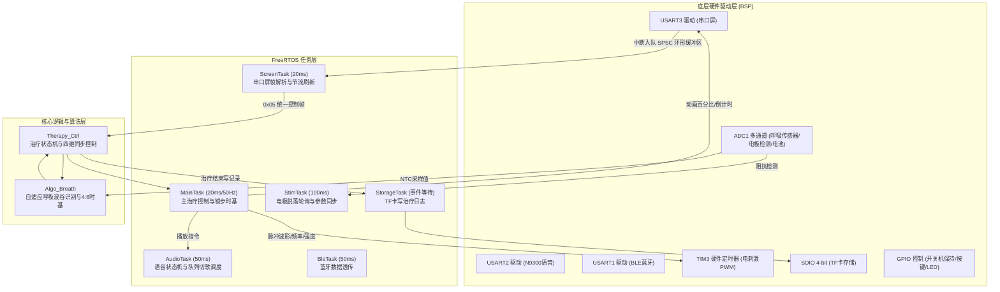

# 呼吸调控与穴位电刺激治疗仪（Breath）软件功能与开发说明文档

> **项目名称**：脂肪肝便携式呼吸调控仪（慢呼吸引导 + 低频穴位电刺激治疗仪）  
> **主控平台**：STM32F405RGT6 (ARM Cortex-M4F @ 168MHz, 1MB Flash, 192KB SRAM)  
> **操作系统**：FreeRTOS V9.0.0 (CMSIS-RTOS V1)  
> **人机界面**：淘晶驰（TJC）USART HMI 串口屏 (USART3 @ 115200 8N1)  
> **音频解码**：N9300 MP3/WAV 硬解码芯片 (USART2 @ 9600 8N1 + PB8 BUSY)  
> **文档生成时间**：2026-11-15  

---

## 目录
1. [系统整体架构与任务拓扑](#1-系统整体架构与任务拓扑)
2. [串口屏人机交互模块（Screen）核心实现与函数使用详解](#2-串口屏人机交互模块screen核心实现与函数使用详解)
   - 2.1 硬件通信拓扑与底层缓冲区设计
   - 2.2 下行数据传输：单片机如何发送指令给屏幕（字符串与数值详解）
   - 2.3 上行数据传输：统一的 0x05 协议架构与解析机制
   - 2.4 15 个页面枚举及事件处理对照表
   - 2.5 串口屏端按键与页面脚本编写标准范例
3. [语音播报控制模块（Audio）功能与实现](#3-语音播报控制模块audio功能与实现)
   - 3.1 硬件架构与 BUSY 引脚状态检测
   - 3.2 链式多段无缝播报队列设计
   - 3.3 频率与定时语音动态音轨映射公式（0014~0019 与 0020~0045）
   - 3.4 生物反馈未检出信号自动重试与回退机制
4. [呼吸引导算法模块（Algorithm）功能与实现](#4-呼吸引导算法模块algorithm功能与实现)
   - 4.1 NTC 呼吸传感器采集与基线自适应跟踪
   - 4.2 4:6 吸呼比时间轴与肺部充盈进度生成
   - 4.3 生物反馈初始 3 次校准均值与动态微调
5. [穴位脉冲电刺激模块（Stimulator）功能与实现](#5-穴位脉冲电刺激模块stimulator功能与实现)
   - 5.1 三种刺激波形输出（连续波、断续波、疏密波）
   - 5.2 呼吸与电刺激四维锁步联动机制
   - 5.3 电极片接触阻抗与脱落检测
6. [主任务调度与治疗状态机（MainTask）](#6-主任务调度与治疗状态机maintask)
7. [历史记录存储模块（Storage）与 FATFS 规范](#7-历史记录存储模块storage与-fatfs-规范)
8. [蓝牙透传模块（Bluetooth）](#8-蓝牙透传模块bluetooth)
9. [电源与电量管理模块（Power）](#9-电源与电量管理模块power)
10. [常见问题与联调排错指南](#10-常见问题与联调排错指南)

---

## 1. 系统整体架构与任务拓扑

本系统基于 **FreeRTOS** 多任务实时操作系统，采用“**时基统一、事件解耦、硬件互斥**”的架构设计。



---

## 2. 串口屏人机交互模块（Screen）核心实现与函数使用详解

串口屏模块包含 3 个核心文件：
* [bsp_screen.h](file:///c:/Users/Administrator/Desktop/淘晶驰git/Breath/Screen/bsp_screen.h)：定义了数据结构、15 个页面枚举及对外接口。
* [bsp_screen.c](file:///c:/Users/Administrator/Desktop/淘晶驰git/Breath/Screen/bsp_screen.c)：实现 SPSC 无锁环形缓冲区、帧定界提取、带互斥锁的串口下发指令。
* [screen_task.c](file:///c:/Users/Administrator/Desktop/淘晶驰git/Breath/Screen/screen_task.c)：FreeRTOS 周期运行任务，统一解析 `0x05` 上行帧，并按页面枚举精准分发业务。

---

### 2.1 硬件通信拓扑与底层缓冲区设计

* **通信接口**：STM32F405 的 **USART3**（`PB10` 为 TX 发送，`PB11` 为 RX 接收）。
* **波特率**：`115200 bps`，8 数据位，1 停止位，无校验（8N1）。
* **无锁环形缓冲区（SPSC Architecture）**：
  * 容量：256 字节（`SCREEN_RX_RING_SIZE`）。
  * USART3 接收中断服务函数 `BSP_Screen_OnUartRxCplt()` 仅更新写入游标 `s_rx_head`；
  * `ScreenTask` 任务中的 `BSP_Screen_ReadFrame()` 仅更新读取游标 `s_rx_tail`；
  * **优势**：读写双方互不干扰，提取和写入过程**无需关闭全局中断**，零系统抖动，保证微秒级电刺激脉冲稳定输出。
* **多任务并发发送互斥锁**：
  驱动层内置 FreeRTOS 互斥锁 `s_tx_mutex`。当 `MainTask`（刷新肺部进度）和 `ScreenTask`（刷新倒计时）并发调用发送接口时，互斥锁确保每条指令的字节流完整发送，**绝不出现字节交织或指令乱码**。

---

### 2.2 下行数据传输：单片机如何发送指令给屏幕（字符串与数值详解）

淘晶驰串口屏接收的是标准的 **ASCII 字符串文本指令**，每条指令末尾必须紧跟 **3 个连续的 `0xFF` 字节**（`\xFF\xFF\xFF`）作为结束符。  
驱动层已对所有指令做了完善的封装，用户无需手动拼装 `0xFF`。

#### ① 发送文本 / 字符串（`BSP_Screen_SetText`）
* **函数原型**：
  ```c
  void BSP_Screen_SetText(const char *obj, const char *attr, const char *txt);
  ```
* **底层拼装的实际指令**：
  `<obj>.<attr>="<txt>"\xFF\xFF\xFF`
  *(注意：字符串内容两端会自动加上英文双引号)*
* **使用范例**：
  ```c
  /* 示例 1：更新倒计时显示控件（t_time 文本控件，显示 15分00秒） */
  BSP_Screen_SetText("t_time", "txt", "15:00");
  // 实际串口发出：t_time.txt="15:00"\xFF\xFF\xFF

  /* 示例 2：弹出 Toast 提示框 */
  BSP_Screen_ShowToast("请佩戴好呼吸传感器");
  ```

#### ② 发送数值 / 进度条 / 变量（`BSP_Screen_SetNum`）
* **函数原型**：
  ```c
  void BSP_Screen_SetNum(const char *obj, const char *attr, int32_t val);
  ```
* **底层拼装的实际指令**：
  `<obj>.<attr>=<val>\xFF\xFF\xFF`
  *(注意：数值是直接跟在等号后面，不带双引号)*
* **使用范例**：
  ```c
  /* 示例 1：更新肺部充盈进度条控件（j0 进度条控件，范围 0~100） */
  BSP_Screen_SetNum("j0", "val", 75);
  // 实际串口发出：j0.val=75\xFF\xFF\xFF

  /* 示例 2：更新电量进度条 */
  BSP_Screen_SetNum("j1", "val", 90);
  // 实际串口发出：j1.val=90\xFF\xFF\xFF

  /* 示例 3：更新全局变量 start.breath_freq（设置引导频率为 8 次/分） */
  BSP_Screen_SetNum("start.breath_freq", "val", 8);
  // 实际串口发出：start.breath_freq.val=8\xFF\xFF\xFF
  ```

#### ③ 控制控件显隐（`BSP_Screen_SetVisible`）
* **函数原型**：
  ```c
  void BSP_Screen_SetVisible(const char *obj, uint8_t visible);
  ```
* **底层拼装的实际指令**：
  `vis <obj>,<1或0>\xFF\xFF\xFF`
* **使用范例**：
  ```c
  /* 显示吸气向左箭头 (p1)，隐藏呼气向右箭头 (p2) */
  BSP_Screen_SetVisible("p1", 1); // 实际串口发出：vis p1,1\xFF\xFF\xFF
  BSP_Screen_SetVisible("p2", 0); // 实际串口发出：vis p2,0\xFF\xFF\xFF
  ```

#### ④ 类似 printf 的变参格式化发送（`BSP_Screen_Printf`）
* **函数原型**：
  ```c
  void BSP_Screen_Printf(const char *format, ...);
  ```
* **底层拼装的实际指令**：
  按照 `format` 格式化后，自动在末尾追加 `\xFF\xFF\xFF` 并通过互斥锁发出。
* **使用范例**：
  ```c
  /* 跳转页面到运行界面 */
  BSP_Screen_Printf("page %s", "jianyi");
  // 实际串口发出：page jianyi\xFF\xFF\xFF

  /* 动态格式化浮点数值输出 */
  BSP_Screen_Printf("t0.txt=\"当前电压: %.2fV\"", 3.74f);
  ```

---

### 2.3 上行数据传输：统一的 0x05 协议架构与解析机制

为了彻底消除之前协议不统一、帧头混乱的痛点，现已**全面统一为一套以 `0x05` 为帧头、以 3 字节 `0xFF 0xFF 0xFF` 为定界符的标准协议**。

#### 统一帧结构规范：
```text
+------+---------+---------+-----------+-----------+-----+--------+--------+--------+
| 0x05 | PageID  | Action  | Param 0   | Param 1   | ... |  0xFF  |  0xFF  |  0xFF  |
+------+---------+---------+-----------+-----------+-----+--------+--------+--------+
  1B       1B        1B        1B          1B              1B       1B       1B
```
* **第 0 字节 `0x05`**：统一协议帧头（`SCREEN_FRAME_HDR_CTRL`）。
* **第 1 字节 `PageID`**：当前发送该帧的**页面编号**（范围 `0x00 ~ 0x0E`，共 15 个页面）。
* **第 2 字节 `Action`**：动作码 / 控件功能码：
  * `0x01`：**启动 / 继续治疗**（Start / Resume）
  * `0x00`：**暂停治疗**（Pause）
  * `0x02` 或 `0x0F`：**停止治疗 / 返回上一页**（Stop / Exit）
  * **`0x08`**：**页面加载就绪通知**（Page Enter Event，用于自动触发语音与校准）
  * `0x10`：**实时音量设置**（Volume 0~10）
  * `0x11`：**实时蓝牙开关**（BLE 0=关，1=开）
* **第 3 字节及后续**：该页面下发的业务参数（如定时时长、频率、通道电刺激强度等）。
* **末尾 3 字节**：淘晶驰标准帧结束符 `0xFF 0xFF 0xFF`。

*(注：底层驱动层 [bsp_screen.c](file:///c:/Users/Administrator/Desktop/淘晶驰git/Breath/Screen/bsp_screen.c#L157-L200) 中保留了平滑容错，若有旧脚本以 `0x5A` 结尾，也会被底层自动剥离并归一化为标准的 `0x05` 帧，绝不丢包)*。

---

### 2.4 15 个页面枚举及事件处理对照表

在 [screen_task.c](file:///c:/Users/Administrator/Desktop/淘晶驰git/Breath/Screen/screen_task.c#L19-L240) 中，核心函数 `Screen_HandleCtrlFrame` 使用顶层 `switch (page)` 对 15 个页面进行分发：

| 页面 ID | 页面枚举 (`ScreenPageId_t`) | 页面名称 | 触发动作 (`action`) | 单片机响应行为 |
| :---: | :--- | :--- | :---: | :--- |
| `0x00` | `SCREEN_PAGE_START` | 开机主界面 | `0x08` | 播放 `0001`（欢迎使用呼吸调控仪...） |
| `0x01` | `SCREEN_PAGE_ELECMODE` | 电刺激模式选择 | `0x08` | 播放 `0011`（请选择电刺激模式） |
| `0x02` | `SCREEN_PAGE_BREATHMODE` | 呼吸引导模式选择 | `0x08` | 播放 `0002`（请选择呼吸引导模式） |
| `0x03` | `SCREEN_PAGE_LIANHEMODE1` | 联合选呼吸模式 | `0x08` | 播放 `0002`（请选择呼吸引导模式） |
| `0x0A` | `SCREEN_PAGE_LIANHEMODE2` | 联合选电刺激模式 | `0x08` | 播放 `0011`（请选择电刺激模式） |
| `0x04` | `SCREEN_PAGE_JIANYI` | **简易呼吸测量运行** | `0x08`<br>`0x01`<br>`0x00`<br>`0x02` | 播报 `0009`（请点击启停键...）<br>启动简易呼吸引导治疗（参数：定时/音量/蓝牙）<br>暂停治疗<br>停止治疗并返回主菜单 |
| `0x06` | `SCREEN_PAGE_JIANYIELEC` | **简易呼吸+电刺激运行** | `0x08`<br>`0x01`<br>`0x00`<br>`0x02` | 播报 `0009`（请点击启停键...）<br>启动联合治疗（波形/频率/3通道强度/定时）<br>暂停治疗<br>停止治疗并返回主菜单 |
| `0x07` | `SCREEN_PAGE_FANKUI` | **生物反馈呼吸运行** | `0x08`<br>`0x01`<br>`0x00`<br>`0x02` | **启动呼吸传感器采样并播报 `0007` 引导校准**<br>校准完成后点击启动治疗<br>暂停治疗<br>停止治疗并返回主菜单 |
| `0x09` | `SCREEN_PAGE_FANKUIELEC` | **生物反馈+电刺激运行** | `0x08`<br>`0x01`<br>`0x00`<br>`0x02` | **启动呼吸传感器采样并播报 `0007` 引导校准**<br>启动反馈联合治疗（全量参数）<br>暂停治疗<br>停止治疗并返回主菜单 |
| `0x0B` | `SCREEN_PAGE_ELEC` | **单独电刺激治疗运行** | `0x08`<br>`0x01`<br>`0x00`<br>`0x02` | 播报 `0009`（请点击启停键...）<br>启动纯电刺激脉冲输出（波形/频率/3通道/定时）<br>暂停治疗<br>停止治疗并返回主菜单 |
| `0x05` | `SCREEN_PAGE_JIANYISET` | 简易呼吸设置 | `0x10`<br>`0x11` | 实时调节音量（0~10 档）<br>实时开关蓝牙 |
| `0x08` | `SCREEN_PAGE_FANKUISET` | 反馈呼吸设置 | `0x10`<br>`0x11` | 实时调节音量 / 蓝牙 |
| `0x0C` | `SCREEN_PAGE_ELECSET` | 电刺激参数设置 | `0x10`<br>`0x11` | 实时调节音量 / 蓝牙 |
| `0x0D` | `SCREEN_PAGE_LIANHESET1` | 联合模式简易设置 | `0x10`<br>`0x11` | 实时调节音量 / 蓝牙 |
| `0x0E` | `SCREEN_PAGE_LIANHESET2` | 联合模式反馈设置 | `0x10`<br>`0x11` | 实时调节音量 / 蓝牙 |

---

### 2.5 串口屏端按键与页面脚本编写标准范例

为了与单片机的统一解析匹配，在淘晶驰上位机 USART HMI 中，脚本编写规范如下：

#### 范例 1：页面加载就绪通知（Page Postinitialize Event）
在每个页面的空白处点击，在右侧属性面板的 **“初始化后事件”** 中写入：
```c
// 在 page 4 (jianyi 页面) 的初始化后事件中写：
printh 05 04 08 FF FF FF

// 在 page 7 (fankui 页面) 的初始化后事件中写：
printh 05 07 08 FF FF FF
```

#### 范例 2：治疗界面的“开始/暂停”按钮（b1 按键弹起事件）
以 `page 6`（简易联合治疗）为例，点击启动时带入模式、频率、三通道强度、定时：
```c
if(start.run.val==0)
{
    // 处于未运行状态 -> 点击后启动
    start.run.val=1
    // printh [帧头 05] [页面 06] [动作 01] [模式] [频率] [CH1] [CH2] [CH3] [定时] [3个FF]
    printh 05 06 01 start.mode_sel.val start.fre.val start.ch1.val start.ch2.val start.ch3.val start.set_time.val FF FF FF
}
else
{
    // 处于运行状态 -> 点击后暂停
    start.run.val=0
    printh 05 06 00 FF FF FF
}
```

#### 范例 3：返回上一页按钮（b0 或 b2 按键弹起事件）
```c
// 发送返回主菜单指令
printh 05 06 02 FF FF FF
// 屏幕自身执行页面跳转
page start
```

#### 范例 4：设置界面的音量滑动条 / 蓝牙开关
```c
// 音量滑动条值改变事件：
printh 05 05 10 h0.val FF FF FF

// 蓝牙开关按钮点击事件：
printh 05 05 11 bt0.val FF FF FF
```

---

## 3. 语音播报控制模块（Audio）功能与实现

语音模块基于 **N9300** 串口硬解码芯片开发（挂载 W25Q64 SPI-Flash 与 8002A 差分音频功放）。

### 3.1 硬件架构与 BUSY 引脚状态检测
* **串口连接**：STM32F405 的 **USART2**（`PA2` 为 TX，`PA3` 为 RX，波特率 `9600 8N1`）。
* **BUSY 引脚**：连接至单片机 **`PB8`**（上拉输入）。
  * **N9300 硬件电气极性**：
    * **正在播放音频时**：BUSY 输出**低电平（0V，`GPIO_PIN_RESET`）**；
    * **静止 / 播放结束时**：BUSY 输出**高电平（3.3V，`GPIO_PIN_SET`）**。
  * [bsp_audio.c](file:///c:/Users/Administrator/Desktop/淘晶驰git/Breath/Audio/bsp_audio.c#L239-L243) 中的 `BSP_Audio_IsBusy()` 正确返回 `RESET ? 1 : 0`，实现播放状态的精准毫秒级捕捉。

---

### 3.2 链式多段无缝播报队列设计
在 [bsp_audio.c](file:///c:/Users/Administrator/Desktop/淘晶驰git/Breath/Audio/bsp_audio.c#L172-L193) 中设计了自动播放队列 `s_play_queue`：
1. 一次性调用 `BSP_Audio_PlayQueue(tracks, count)` 载入多段音轨。
2. 先立即触发第 1 首播放。
3. `AudioTask`（50ms 周期）持续轮询 `BSP_Audio_Poll()`：当检测到 BUSY 引脚从低电平跳变为高电平（即上一首刚刚播完），且经过 200ms 防抖后，**立刻自动下发下一首的播放指令**。
4. 队列中内置 4000ms 超时保护机制，防止个别音频文件因硬件故障导致队列卡死。

---

### 3.3 频率与定时语音动态音轨映射公式

说明书中要求：
* **(1) 频率音轨**：`0014 ~ 0019` 对应 `5 次每分钟 ~ 10 次每分钟`。
* **(2) 定时音轨**：`0020 ~ 0045` 对应 `5 分钟 ~ 30 分钟`。

#### 频率映射与防溢出保护：
$$\text{音轨序号} = 14 + (\text{引导频率 BPM} - 5) = \text{BPM} + 9$$
* 入口双重限幅：若检测或计算值 $\le 5$，默认调到 5 次/分；若 $> 10$，最大限制为 10 次/分。
* **播报序列**：`[0008] 本次你的起始呼吸引导频率为` $\to$ `[0014~0019] xx次每分钟` $\to$ `[0009] 请点击启停键...`。

#### 定时时长映射：
$$\text{音轨序号} = 20 + (\text{定时分钟 MIN} - 5) = \text{MIN} + 15$$
* 范围限幅：$5 \le \text{MIN} \le 30$。
* **播报序列**：`[0010] 本次治疗结束，有效时长为` $\to$ `[0020~0045] xx分钟` $\to$ `[0012] 本次治疗结束，请关闭仪器`。

---

### 3.4 生物反馈未检出信号自动重试与回退机制
在 [therapy_ctrl.c](file:///c:/Users/Administrator/Desktop/淘晶驰git/Breath/MainTask/therapy_ctrl.c#L497-L536) 中实现了完整的状态机：
* 进入 `fankui` 页面后，首先播放 `0007` 引导呼气吸气；
* 若传感器未接入或未检测到完整呼吸信号，在 `0007` 播完 5 秒后，自动重新播放 `0007`；
* **最多重复播放 3 次**；
* 若重试满 3 次仍未检测到呼吸信号，系统自动兜底：将引导频率设为 **5 次/分钟**，屏幕显示框更新为 `5`，并直接播报 **`0013`**（*“本次你的起始呼吸引导频率为5次每分钟，请点击启停键或右下角设置按钮设置好参数后开启治疗”*）。

---

## 4. 呼吸引导算法模块（Algorithm）功能与实现

文件位于 `Algorithm/Src/algo_breath.c` 与 `Algorithm/Inc/algo_breath.h`。

### 4.1 NTC 呼吸传感器采集与基线自适应跟踪
* **硬件接口**：NTC 热敏电阻置于耳挂式鼻部麦克风内，由单片机 ADC1 连续采样（50Hz / 20ms）。
* **自适应基线跟踪**：人体呼出的热气会使阻值产生波动。算法使用一阶惯性滤波实时提取漂移的直流基线：
  $$\text{Baseline} = 0.98 \times \text{Baseline} + 0.02 \times \text{Raw}$$
  将原始值减去基线后提取交流呼吸分量，滤除环境温漂。

---

### 4.2 4:6 吸呼比时间轴与肺部充盈进度生成
医学临床研究表明，慢呼吸最佳吸呼比为 **4 : 6**（吸气占周期的 40%，呼气占周期的 60%）。
* **吸气阶段（前 40% 时间）**：
  * 肺部充盈进度条从 $0 \to 100$ 线性上升；
  * 左箭头 `p1` 点亮，右箭头 `p2` 熄灭；
  * 相位切换瞬间播放 `0003`（“吸”）。
* **呼气阶段（后 60% 时间）**：
  * 肺部充盈进度条从 $100 \to 0$ 线性下降；
  * 左箭头 `p1` 熄灭，右箭头 `p2` 点亮；
  * 相位切换瞬间播放 `0004`（“呼”）。

---

### 4.3 生物反馈初始 3 次校准均值与动态微调
* **初始校准**：算法检测 3 次完整呼吸的波谷时间差 $\Delta t_1, \Delta t_2, \Delta t_3$，计算出平均实时呼吸频率：
  $$\text{avg3} = \frac{\text{BPM}_1 + \text{BPM}_2 + \text{BPM}_3}{3}$$
  按说明书强制约束在 $5 \sim 10$ 次/分之间。
* **治疗中闭环微调**：在生物反馈治疗过程中，每 3 次呼吸检测一次。如果用户能较好跟随当前引导频率，算法会自动逐步下调引导频率（每次降 1 次/分，直至最低 5 次/分），诱导呼吸变慢变深。

---

## 5. 穴位脉冲电刺激模块（Stimulator）功能与实现

文件位于 `Stimulator/bsp_stimulator.c`、`Stimulator/bsp_stimulator.h` 与 `Stimulator/stim_task.c`。

### 5.1 硬件电路拓扑与控制架构
系统采用医疗级**“高压闭环升压（Boost） + 运放受控恒流源（CC Sink） + MOS H桥双极性倒相”**拓扑：
1. **闭环升压（Boost）**：通过 TIM5/TIM14/TIM4 PWM 控制升压电感，输出 5V~30V 目标高压，经 100k/4.7k 分压反馈给 ADC，PI 算法闭环调压。
2. **运放恒流源（CC Sink）**：通过 TIM3/TIM12 输出低通滤波 PWM 作为 DAC 基准电压（$V_{ref} = 0 \sim 300\text{mV}$），配合 LM324 运放驱动 MOS 管，在 $10\,\Omega$ 采样分流电阻上精确产生 $0 \sim 30\text{mA}$ 恒定峰值脉冲电流。
3. **双极性 H 桥驱动**：TIM2 产生 $50\mu\text{s}$ 节拍中断，精确合成“$250\mu\text{s}$ 正脉冲 $\to 50\mu\text{s}$ 死区 $\to 250\mu\text{s}$ 负脉冲”的对称平衡方波，防止人体皮肤电解损伤。

---

### 5.2 电刺激档位与电压/电流对照表

在代码 [bsp_stimulator.c#L324-L345](file:///c:/Users/Administrator/Desktop/淘晶驰git/Breath/Stimulator/bsp_stimulator.c#L324-L345) 中，系统根据当前通道设定档位（0~10 档）进行动态线性计算：

| 刺激档位 (Level) | 峰值恒定电流 ($I_{peak}$) | 恒流采样基准电压 ($V_{shunt}$) | 恒流 DAC PWM 计数值 (`CCR`) | Boost 目标升压电压 ($V_{boost}$) | 典型适应人体阻抗上限 ($R_{load}$) | 刺激强度与人体感受说明 |
| :---: | :---: | :---: | :---: | :---: | :---: | :--- |
| **0 档** | **0.0 mA** | 0 mV | 0 | 0.0 V (关断) | — | 输出关闭，H 桥全断开 |
| **1 档** | **3.0 mA** | 30 mV | 90 | **7.5 V** | $\le 2500\,\Omega$ | 极微弱，轻微麻刺感（初次适应） |
| **2 档** | **6.0 mA** | 60 mV | 181 | **10.0 V** | $\le 1666\,\Omega$ | 微弱，温和跳动感 |
| **3 档** | **9.0 mA** | 90 mV | 271 | **12.5 V** | $\le 1388\,\Omega$ | 轻度刺激，局部肌肉轻度收缩 |
| **4 档** | **12.0 mA** | 120 mV | 362 | **15.0 V** | $\le 1250\,\Omega$ | 中度刺激，穴位酸胀感明显 |
| **5 档** | **15.0 mA** | 150 mV | 453 | **17.5 V** | $\le 1166\,\Omega$ | 标准治疗起始档，腹部节律收缩 |
| **6 档** | **18.0 mA** | 180 mV | 543 | **20.0 V** | $\le 1111\,\Omega$ | 强化治疗档，较强肌肉节律收缩 |
| **7 档** | **21.0 mA** | 210 mV | 634 | **22.5 V** | $\le 1071\,\Omega$ | 强刺激，穴位深层透穴感 |
| **8 档** | **24.0 mA** | 240 mV | 724 | **25.0 V** | $\le 1041\,\Omega$ | 深度治疗档，适用于厚腹部脂肪层 |
| **9 档** | **27.0 mA** | 270 mV | 815 | **27.5 V** | $\le 1018\,\Omega$ | 极强刺激（耐受良好患者） |
| **10 档** | **30.0 mA** | 300 mV | 906 (满偏) | **30.0 V** | $\le 1000\,\Omega$ | 最大输出上限，强力腹肌运动 |

> [!NOTE]
> **计算公式推导：**
> 1. **峰值电流**：$I_{peak} = \frac{\text{Level}}{10} \times 30.0\text{ mA} = \text{Level} \times 3.0\text{ mA}$
> 2. **恒流 DAC 占空比**：$\text{CCR} = \frac{\text{Level}}{10} \times \text{CC\_DAC\_CCR\_30MA} = \frac{\text{Level}}{10} \times 906$
> 3. **升压目标电压**：$V_{boost} = 5.0\text{ V} + \frac{\text{Level}}{10} \times (30.0\text{ V} - 5.0\text{ V}) = 5.0\text{ V} + \text{Level} \times 2.5\text{ V}$

---

### 5.3 缓启动与安全防护机制
* **3 秒平滑缓升（Ramp-Up）**：档位由低调高或脱落重新恢复时，电流以 10ms 为步长在 3000ms（3 秒）内平滑爬升到目标档位，彻底消除突发脉冲导致的电击刺痛感。
* **电极接触阻抗与脱落检测**：在每次脉冲期间采样人体电极回路回读信号。当回路开路或阻抗异常导致采样低于 `ELEC_VALID_ADC_THRESH`（持续 5 秒）时判定为电极脱落。立即关断 PWM 将电流压为 0，防止用户重新贴上时被电击，并通过屏幕与语音报警。

---

### 5.4 三种刺激波形输出
硬件通过 `TIM2` 状态机配合 H 桥双向驱动：
* **连续波（Continuous Wave）**：脉冲频率恒定连续输出。
* **断续波（Intermittent Wave）**：输出 1.5 秒，停止 1.5 秒，交替循环。
* **疏密波（Dense-Sparse Wave）**：疏波（低频 0~20Hz）输出 3 秒，密波（高频 5~100Hz）输出 3 秒，周期交替。

---

### 5.5 呼吸与电刺激四维锁步联动机制
在联合模式下，电刺激与呼吸引导执行**同相位锁步调制**：
* 当处于**吸气阶段**时：电刺激自动降至微弱刺激（或占空比调小），让膈肌与腹肌充分放松；
* 当处于**呼气阶段**时：电刺激恢复为用户设定的目标强度，刺激腹部经络穴位，强化腹肌收缩与内脏脂肪代谢。

---

## 6. 主任务调度与治疗状态机（MainTask）

文件位于 `MainTask/therapy_ctrl.c` 与 `MainTask/app_types.h`。
* `App_Therapy_UnifiedTimeAxisStep20ms(now_ms)` 每 20ms 执行一次，作为整个系统的“节拍器”。
* 状态机生命周期：
  ```text
  APP_STATE_MENU (菜单选择)
         │
         ▼
  APP_STATE_BIO_CALIB (生物反馈 3次呼吸校准中)
         │
         ▼
  APP_STATE_READY (就绪，已计算好起始频率，等待启动)
         │  [用户点击启动按键 b1]
         ▼
  APP_STATE_RUNNING (治疗运行中：肺部动画、倒计时递减、脉冲输出)
     │        ▲
     │        │ [点击继续]
     ▼        │
  APP_STATE_PAUSED (治疗暂停)
     │
     ▼ [倒计时归零]
  APP_STATE_FINISHED (治疗结束，播报 0010 + 时长 + 0012，写 TF 卡，10s 自动关机)
  ```

---

## 7. 历史记录存储模块（Storage）与 FATFS 规范

文件位于 `Storage/bsp_storage.c` 与 `Storage/storage_task.c`。
* **接口**：SDIO 4 位总线模式，挂载 FatFs 文件系统。
* **即插即用检测**：检测 `PB0 (SDIO_CD)` 引脚电平，支持热插拔。
* **日志格式**：治疗结束时，自动以追加模式写入 SD 卡根目录的 `TREAT.LOG` 二进制与文本文件：
  ```text
  [2026-11-15 15:30:00] Mode=BioCombo, StimFreq=10Hz, CH1=5, CH2=5, CH3=5, ValidTime=900s, FinalBPM=6
  ```

---

## 8. 蓝牙透传模块（Bluetooth）

文件位于 `Bluetooth/bsp_ble.c` 与 `Bluetooth/ble_task.c`。
* **接口**：USART1（`PA9/TX`，`PA10/RX`，波特率 `115200 8N1`）+ `PB2 (BLE_INT)` 外部中断唤醒。
* **功能**：与手机端小程序/APP 互联，支持在手机上实时监视呼吸引导波形、同步治疗记录、远程启动/暂停。

---

## 9. 电源与电量管理模块（Power）

文件位于 `MainTask/bsp_power.c`。
* **单键软开关机**：
  * 开机按键：`PA0 (KEY_ON)`；
  * 电源保持引脚：`PA5 (PWR_ON)`；长按 1.5 秒开机后，单片机将 `PWR_ON` 拉高锁定供电。
* **自动省电关机**：
  * 治疗结束后 10 秒无按键操作，单片机主动拉低 `PWR_ON`，整机彻底切断电源，静态待机功耗为 0。
* **电池电量计算**：
  * ADC 采样锂电池分压电压（3.4V~4.2V），线性映射为 0~100% 进度，每 10 秒刷新至串口屏右上角 `j1` 电量条。

---

## 10. 常见问题与联调排错指南

### Q1: 串口屏点击无反应？
1. 检查 USART3 硬件连线是否交叉：单片机 `PB10 (TX)` 接串口屏 `RXD`，`PB11 (RX)` 接串口屏 `TXD`。
2. 确认串口屏波特率设置为 `115200`。
3. 检查串口屏按钮脚本是否写了 `printh 05 ... FF FF FF`。

### Q2: 语音不播报或播报卡顿？
1. 确认 N9300 SD 卡或 SPI-Flash 内部文件名是否严格以 4 位数字命名（如 `0001.mp3`, `0008.mp3`, `0014.mp3`）。
2. 确认 `PB8 (AUDIO_BUSY)` 引脚电平极性：正常播放时应为低电平（0V），播完为空闲高电平（3.3V）。
3. 检查耳机插座 `PA4 (HP_DET)`：插入耳机时会自动切断板载 8002A 喇叭功放。

### Q3: 生物反馈一直停留在校准界面？
1. 检查耳挂麦克风 NTC 探头是否插好；
2. 佩戴时将 NTC 热敏头对准鼻孔下方约 1~2cm 处；
3. 根据语音 `0007` 的节奏做 3 次平稳的深呼吸（吸 2.4s，呼 3.6s），算法即可检出波谷并自动跳入就绪状态。如果 3 次未检出，系统也会自动回退至 5 次/分并播报 `0013`。

---
*本文档对应工程编译状态：`Keil MDK V5.06 update 6 - 0 Error(s), 0 Warning(s) - Breath.hex`*
